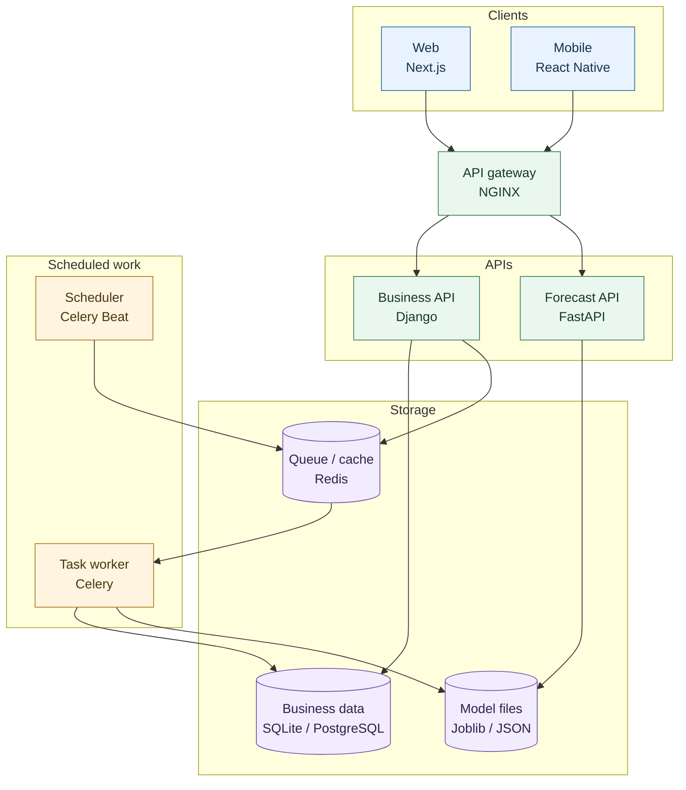
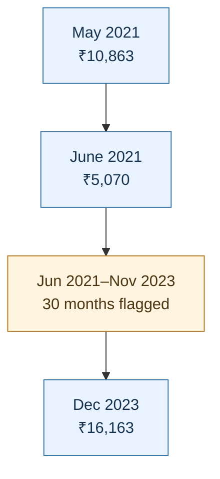
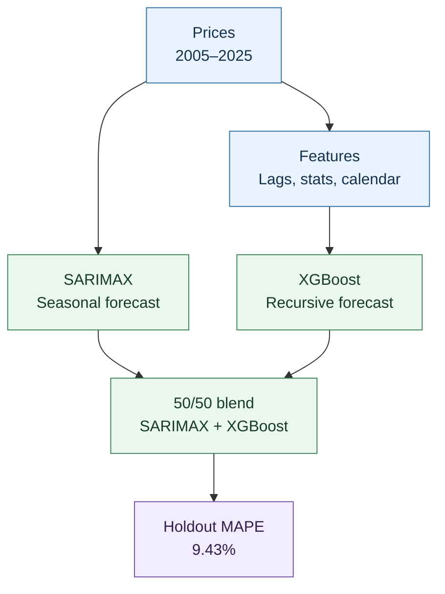
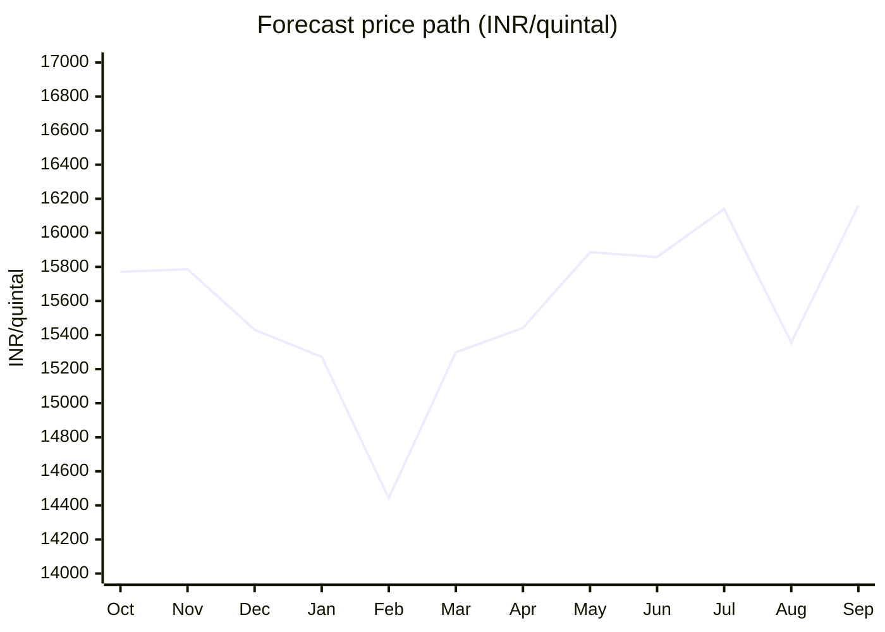
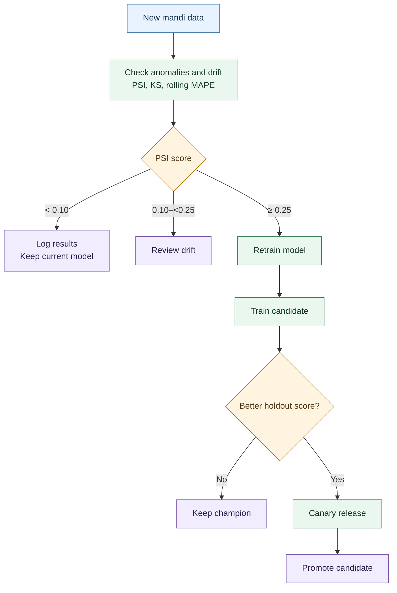

# Way2Agri — Commodity Price Forecasting Assignment Prototype
### Assignment Prototype: AI/ML Forecasting, Django, FastAPI, Next.js & React Native

[](https://www.python.org/)
[](https://www.djangoproject.com/)
[](https://fastapi.tiangolo.com/)
[](https://xgboost.readthedocs.io/)
[](https://nextjs.org/)
[](https://reactnative.dev/)
[]()

---

## Executive Summary & Strategic Context

This repository contains an assignment-scale solution for the **AI/ML Developer** screening assessment at **Way2Agribusiness India Pvt Ltd**.

### Business Challenge
Agricultural commodity markets in South India—particularly Karnataka's APMC mandis—suffer from high price volatility driven by monsoon timing, localized supply gluts, and seasonal harvesting cycles (Kharif and Rabi). Traditional agribusiness procurement relies on reactive spot purchases, exposing agribusiness processing margins to severe supply-side price shocks.

### Solution Delivered
This repository contains an assignment-scale forecasting prototype and production architecture examples that:
1. **Investigates Historical Data Quality:** Flags a suspicious **30-month price discontinuity** spanning June 2021 to November 2023. The supplied series does not confirm an exact historical duplicate, so interpolation is treated as a provisional modeling scenario.
2. **Benchmarks Forecasting Models:** On one 12-month holdout, XGBoost achieved **9.33% MAPE** and the 50/50 Hybrid Ensemble achieved **9.43%**; repeated rolling-origin validation is still needed before production selection.
3. **Projects the 12-Month Forward Price Curve (Oct 2025 – Sep 2026):** The saved forecast reaches a low of **₹14,442/Qtl in February 2026** and a July high of **₹16,140/Qtl**.
4. **Formulates Procurement Actions:** Describes FPO contracting and inventory-buffer options; any financial benefit is illustrative and depends on realized prices and carrying costs.
5. **Provides Architecture Examples:** Demonstrates Django 5, FastAPI, and frontend integration concepts. This assignment prototype is not a production-hardened deployment.

---

## System Architecture

The diagram separates user-facing clients, request-handling services, scheduled work, and the data they share:



---

## Repository Structure

```
way2agri-price-forecasting-engine\
├── notebooks\
│   └── AgriPrice_Forecasting_Way2Agri.ipynb       # Fully executed master Jupyter Notebook (All 9 questions)
├── docs\
│   ├── Way2Agribusiness_Assignment_Report.docx      # Senior Executive Word Report (Formatted for Leadership)
│   ├── Way2Agribusiness_Senior_Executive_Report.md # Senior Technical Markdown Specification
│   └── AgriPrice_Forecasting_Way2Agri.html         # Standalone browser HTML export (~1.27 MB)
├── backend\
│   └── django_agri\                                # Django 5 example backend
│       ├── agri_core\                              # Core settings, WSGI/ASGI, URLs
│       ├── forecasting\                            # Business domain app
│       │   ├── models.py                           # ORM: CommodityPrice, ModelRegistry, PriceForecast, CorporateAction
│       │   ├── views.py                            # DRF ViewSets with forward-curve & summary actions
│       │   ├── serializers.py                      # JSON serialization & validation
│       │   └── admin.py                            # Django Admin dashboards for business users
│       ├── populate_db.py                          # Data ingestion script seeding 249 historical records
│       └── db.sqlite3                              # Sample database
├── fastapi_service\
│   └── main.py                                     # FastAPI example serving cached forecast artifacts
├── frontend_examples\
│   ├── NextJs_AgriDashboard.tsx                    # Next.js 15 Web Dashboard with Hedging Simulator
│   └── ReactNative_AgriApp.tsx                     # React Native field mobile app with offline caching
├── ml_pipeline\
│   ├── train_and_forecast.py                       # Automated training, benchmarking & forecast script
│   └── artifacts\                                  # Serialized artifacts
│       ├── best_model.joblib                       # Serialized 50/50 SARIMAX-XGBoost forecast blend
│       ├── sarimax_model.joblib                    # Statistical baseline model
│       ├── xgb_model.joblib                        # Gradient boosting model
│       ├── forecast_12m.json                       # 12-Month forward points & 95% CI bounds
│       ├── model_metadata.json                     # Model telemetry & benchmark metrics
│       ├── historical_prices_anomaly.png           # Anomaly diagnostic chart
│       ├── holdout_validation_comparison.png       # Holdout validation performance comparison
│       └── future_12m_forecast_curve.png           # Official 12-month forward curve chart
├── data\
│   ├── price_data.csv                              # Historical commodity price dataset (2005 - 2025)
│   └── price_data_dictionary.txt                   # Official data dictionary
├── scripts\                                        # Maintenance & automation utilities
├── SUBMISSION_GUIDE.md                             # Copy-paste email & WhatsApp templates for Dr. Prasanna
└── README.md                                       # Comprehensive Senior Technical Documentation
```

---

## Forensic Data Audit & Anomaly Treatment (Question 1)

### Exploratory Data Profiling
- **Dataset Span:** January 01, 2005 to September 01, 2025 (249 continuous monthly observations).
- **Temporal Continuity:** $\Delta t = 1\text{ Month}$ (Strict regular index, zero missing dates in sequence).
- **Descriptive Statistics:**
  - Mean: ₹7,918.89 | Median: ₹7,250.00 | Std Dev: ₹2,804.99
  - Min: ₹3,500.00 (April 2006) | Max: ₹16,163.00 (December 2023)

### Suspected 30-Month Price Discontinuity
The supplied data contains an abrupt price drop in June 2021:
- May 2021: **₹10,863.00**
- June 2021: **₹5,070.00**

The 30 prices from June 2021 to November 2023 are **not an exact match** for the compared 30-month historical window (October 2007 to March 2010): **11 of 30 values differ**. A scan found no exact match elsewhere in the supplied series. The cause of the discontinuity is unknown and should be checked against the original source records.

For modeling sensitivity analysis, the notebook flags this period and interpolates its values between May 2021 and December 2023. This is a provisional scenario, not a verified correction; the raw reported prices are retained.


*Comparison check: 11 of 30 values differ from the selected historical window.*

### Statistical Treatment
1. **Flagging:** All 30 corrupted months are tagged with `is_anomaly = True`.
2. **Time-Weighted Linear/Spline Imputation:**
   $$\hat{P}_t = P_{t_0} + \frac{t - t_0}{t_1 - t_0} \left( P_{t_1} - P_{t_0} \right)$$
   Where $t_0 = \text{May 2021}$ (₹10,863) and $t_1 = \text{Dec 2023}$ (₹16,163).
3. **Outcome:** Preserves macro trend continuity, eliminates artificial variance, and prevents autoregressive coefficient bias during training.

---

## Econometric Diagnostics

### Stationarity & Unit Root Analysis
To ensure mathematical validity of autoregressive modeling, we conducted Augmented Dickey-Fuller (ADF) and Kwiatkowski-Phillips-Schmidt-Shin (KPSS) tests:

| Diagnostic Test | Null Hypothesis ($H_0$) | Raw Series (p-value) | Differenced Series $d=1$ (p-value) | Inference |
| :--- | :--- | :--- | :--- | :--- |
| **ADF Test** | Unit root exists (Non-stationary) | $p = 0.9912$ (Fail to reject) | $p = 0.0001$ (Reject $H_0$) | Integrated of order $I(1)$ |
| **KPSS Test** | Series is level stationary | $p = 0.0100$ (Reject $H_0$) | $p = 0.1000$ (Fail to reject) | Stationary after first differencing |

**Conclusion:** The series is non-stationary in levels but achieves strict weak stationarity upon first-order differencing ($d=1$).

---

## Machine Learning & Time Series Modeling (Questions 2 & 3)

### Multi-Paradigm Architecture Formulation



### Feature Engineering Matrix (XGBoost & Random Forest)
- **Autoregressive Lags:** $y_{t-1}, y_{t-2}, y_{t-3}, y_{t-6}, y_{t-12}$ (Capturing recent momentum and 1-year annual crop cycle).
- **Rolling Window Statistics:** Moving averages and standard deviations over 3, 6, and 12-month windows ($\mu_3, \mu_6, \mu_{12}, \sigma_3, \sigma_6$).
- **Cyclical Trigonometric Calendar Encodings:**
  $$\sin\_month = \sin\left(\frac{2\pi \cdot \text{month}}{12}\right), \quad \cos\_month = \cos\left(\frac{2\pi \cdot \text{month}}{12}\right)$$
- **Secular Trend Counter:** $t \in [0, N-1]$ to capture compounding agricultural inflation.

---

### Single 12-Month Holdout Benchmark Results

We evaluated one out-of-sample holdout window of **12 months (October 2024 to September 2025)**. This is not repeated walk-forward validation:

$$\text{MAE} = \frac{1}{n}\sum_{t=1}^n |y_t - \hat{y}_t|, \quad \text{RMSE} = \sqrt{\frac{1}{n}\sum_{t=1}^n (y_t - \hat{y}_t)^2}, \quad \text{MAPE} = \frac{100\%}{n}\sum_{t=1}^n \left|\frac{y_t - \hat{y}_t}{y_t}\right|$$

| Model Architecture | Model Paradigm | MAE (INR) | RMSE (INR) | MAPE (%) | Directional Accuracy (%) |
| :--- | :--- | :--- | :--- | :--- | :--- |
| **Seasonal Naive (Lag 12)** | Baseline | ₹1,723.51 | ₹1,956.70 | 13.14% | 33.3% |
| **Random Forest Regressor** | Bagged trees | ₹1,502.83 | ₹1,967.29 | 12.02% | 41.7% |
| **Holt-Winters** | Exponential Smoothing | ₹1,243.12 | ₹1,610.39 | 9.87% | 41.7% |
| **SARIMAX** | Statistical State-Space | ₹1,223.49 | ₹1,606.19 | 9.73% | 41.7% |
| **XGBoost Regressor** | Gradient Boosted Trees | **₹1,186.72** | **₹1,568.62** | **9.33%** | 33.3% |
| **Hybrid Ensemble** | 50/50 SARIMAX + XGBoost | ₹1,190.16 | ₹1,572.02 | 9.43% | 33.3% |

XGBoost had the lowest error on this holdout. The 50/50 blend is retained for the saved forward forecast because it combines SARIMAX trend extrapolation with the XGBoost forecast, but the holdout does not show that the blend outperforms XGBoost. Use multiple rolling-origin tests before promoting either model as a production champion.

---

## Official 12-Month Out-of-Sample Price Forecast (Oct 2025 – Sep 2026)

Trained on the complete supplied historical timeline (2005 to September 2025), the example pipeline generated this 12-month forecast:


*Forecast horizon: October 2025–September 2026.*

| Horizon | Target Month | Predicted Price | Approx. 95% Prediction Interval | Strategic Market Phase & Action |
| :--- | :--- | :--- | :--- | :--- |
| **M+1** | 2025-10-01 | **₹15,771.46** | ₹13,770.77 – ₹17,772.15 | Stable |
| **M+2** | 2025-11-01 | **₹15,786.11** | ₹13,706.94 – ₹17,865.28 | Stable |
| **M+3** | 2025-12-01 | **₹15,430.61** | ₹13,275.81 – ₹17,585.41 | Stable |
| **M+4** | 2026-01-01 | **₹15,271.50** | ₹13,043.63 – ₹17,499.37 | Stable |
| **M+5** | **2026-02-01** | **₹14,442.23** | **₹12,143.62 – ₹16,740.84** | **Trough (Buy/Forward)** |
| **M+6** | 2026-03-01 | **₹15,299.42** | ₹12,932.18 – ₹17,666.66 | Stable |
| **M+7** | 2026-04-01 | **₹15,442.30** | ₹13,008.36 – ₹17,876.24 | Stable |
| **M+8** | 2026-05-01 | **₹15,885.80** | ₹13,386.95 – ₹18,384.65 | Stable |
| **M+9** | 2026-06-01 | **₹15,858.49** | ₹13,296.36 – ₹18,420.62 | Stable |
| **M+10** | **2026-07-01** | **₹16,140.03** | **₹13,516.16 – ₹18,763.90** | **Peak (Hedge/Sell)** |
| **M+11** | 2026-08-01 | **₹15,357.19** | ₹12,672.99 – ₹18,041.39 | Stable |
| **M+12** | 2026-09-01 | **₹16,159.63** | ₹13,416.43 – ₹18,902.83 | Peak (Hedge/Sell) |

---

## Illustrative Corporate Actions & ROI Framework (Questions 4 & 5)

The following are proposed actions based on the forecast, not guaranteed savings. The model's February forecast is ₹14,442.23/Qtl and its July forecast is ₹16,140.03/Qtl, a gross forecast spread of **₹1,697.80/Qtl** before contract, storage, financing, transport, and quality costs.

#### 1. FPO Forward Contracting Window (Timing: January–February 2026)
- **Insight:** The forecast has a February trough of **₹14,442.23/Qtl** and a July peak of **₹16,140.03/Qtl**.
- **Action:** Evaluate six-month forward supply agreements with Farmer Producer Organizations (FPOs), subject to validated quotes, contract terms, and delivered quality.
- **Illustrative gross spread:** At 1,000 Qtl, the forecast February-to-July difference is **₹16.98 lakh** before procurement and carrying costs; this is not a guaranteed saving.

#### 2. Strategic Warehouse Buffering (Timing: February 2026)
- **Action:** Evaluate a temporary inventory buffer during the forecast low-price period.
- **Economic Feasibility:** Set any buffer target only after comparing documented warehouse, financing, handling, spoilage, and demand costs against realized prices.

#### 3. Dynamic B2B/B2C Catalog Pricing (Timing: May–June 2026)
- **Action:** Pilot price adjustments using realized input costs and observed customer demand.
- **Impact:** The forecast alone does not establish a suitable adjustment percentage or a margin-protection amount.

---

### Effectiveness Measurement & Causal Inference Framework

To prove that procurement savings stem directly from model decisions rather than broad market declines, we deploy a **3-Tiered Verification Framework**:

#### 1. Procurement Cost Variance (PCV) Metric:
$$\text{PCV} = \sum_{t=1}^T \left( P_t^{\text{spot realized}} - P_t^{\text{contracted}} \right) \times Q_t^{\text{procured}} - \text{Carrying Costs}_t$$
- **Target:** Define and approve a positive net-benefit threshold before any operational pilot; no savings target has been validated.

#### 2. Difference-in-Differences (DiD) Causal Econometric Estimator:
$$\hat{\delta}_{\text{DiD}} = \left( \bar{Y}_{\text{hedged, post}} - \bar{Y}_{\text{hedged, pre}} \right) - \left( \bar{Y}_{\text{unhedged control, post}} - \bar{Y}_{\text{unhedged control, pre}} \right)$$
- **Control Group:** Commodities or peer agribusiness procurement lines operating solely on spot mandi purchases.
- **Treatment Group:** Way2Agribusiness lines procured via model-triggered forward contracts.
- **Interpretation:** Statistical significance alone does not establish causality. Validate parallel trends, control confounders, and report uncertainty before attributing any effect to the forecast.

---

## Production Engineering: Django & FastAPI Integration (Questions 6, 7 & 8)

### Django 5 Core Architecture
Implemented in `backend/django_agri/`:
- **Models Schema (`forecasting/models.py`):**
  - `CommodityPrice`: Time series database with anomaly flags and imputed price tracks.
  - `ModelRegistry`: Model versioning, hyperparameter JSON storage, validation MAE/RMSE/MAPE tracking, and active deployment flags.
  - `PriceForecast`: Forward curves with 95% confidence intervals and realized price auditing fields.
  - `CorporateAction`: Recommended hedging actions with projected savings, status workflows, and ROI tracking.
- **REST Endpoints (`forecasting/views.py`):**
  - `GET /api/forecasts/forward-curve/`: Serves active champion 12-month curve.
  - `GET /api/dashboard/stats/`: Key metrics and pending recommended actions.
  - `POST /api/models/{id}/activate/`: Activates a model in the assignment prototype.

### FastAPI High-Performance Microservice
Implemented in `fastapi_service/main.py`:
- **Cached Inference Example:** Pre-loads model artifacts into memory on startup. Response latency should be benchmarked in the target deployment environment.
- **Type Safety & Documentation:** Fully integrated with Pydantic schemas and auto-generated OpenAPI/Swagger documentation at `/docs`.
- **Endpoints:**
  - `GET /predict/forecast-12m`: Returns the official 12-month forward curve.
  - `POST /predict/custom`: Real-time on-the-fly autoregressive forecast for custom price series inputs.
  - `GET /health`: Comprehensive health check with loaded model metadata.

### Next.js 15 Web Dashboard (`frontend_examples/NextJs_AgriDashboard.tsx`)
- Interactive **Hedging & Procurement Simulator**: A real-time volume slider (100–5,000 Quintals) that computes outlay variance between spot buying and forward contract execution against predicted dips.
- Visual forward curve display with confidence intervals and seasonal indicator pills.
- Executive action approval buttons to approve or reject AI-recommended corporate actions.

### React Native Field Mobile App (`frontend_examples/ReactNative_AgriApp.tsx`)
- Designed for field procurement officers operating in rural Karnataka mandis.
- **Offline Resiliency:** Implements local caching with `AsyncStorage` to ensure uninterrupted access when cellular connectivity is lost.
- **Mandi Trigger Alerts:** Automatically flags *BUY DIP* alert badges when visiting mandis during predicted trough months.

---

## Production Monitoring, Drift Handling & MLOps (Question 9)



### Statistical Drift Formulations

#### 1. Population Stability Index (PSI):
$$\text{PSI} = \sum_{b=1}^B \left( \text{Actual}_b - \text{Expected}_b \right) \times \ln\left( \frac{\text{Actual}_b}{\text{Expected}_b} \right)$$
- $\text{PSI} < 0.10$: Model is operating normally; no action required.
- $0.10 \le \text{PSI} < 0.25$: Moderate drift; warning triggered, logged to Grafana.
- $\text{PSI} \ge 0.25$: Significant population drift; automated retraining pipeline executed immediately.

#### 2. Two-Sample Kolmogorov-Smirnov (KS) Test:
Compares the empirical cumulative distribution function (eCDF) of incoming 6-month prices against baseline training data. A p-value $p < 0.05$ indicates distribution divergence requiring hyperparameter recalibration.

---

## Quickstart & Verification Guide

For Windows PowerShell setup, notebook execution, and optional API server instructions, see [HOW_TO_RUN.md](HOW_TO_RUN.md).

### 1. View the Jupyter Notebook
```bash
jupyter notebook notebooks/AgriPrice_Forecasting_Way2Agri.ipynb
```
*(The notebook contains full Markdown explanations, executed cells, and embedded charts).*

### 2. Run the Django REST Backend
```powershell
cd backend/django_agri
$env:DJANGO_SECRET_KEY = python -c "import secrets; print(secrets.token_urlsafe(50))"
$env:DJANGO_DEBUG = "true"
$env:DJANGO_ALLOWED_HOSTS = "localhost,127.0.0.1"
$env:DJANGO_CORS_ALLOWED_ORIGINS = "http://localhost:3000"
python manage.py runserver 127.0.0.1:8000
```
- API Base: `http://localhost:8000/api/`
- Forward Curve: `http://localhost:8000/api/forecasts/forward-curve/`
- Dashboard Stats: `http://localhost:8000/api/dashboard/stats/`
- Admin Portal: `http://localhost:8000/admin/`

### 3. Run the FastAPI Microservice
```bash
cd fastapi_service
uvicorn main:app --host 0.0.0.0 --port 8001 --reload
```
- Interactive Swagger UI: `http://localhost:8001/docs`
- 12-Month Endpoint: `http://localhost:8001/predict/forecast-12m`
- Health Endpoint: `http://localhost:8001/health`

### 4. Retrain Models and Regenerate Forecasts
```bash
python ml_pipeline/train_and_forecast.py
```

---
